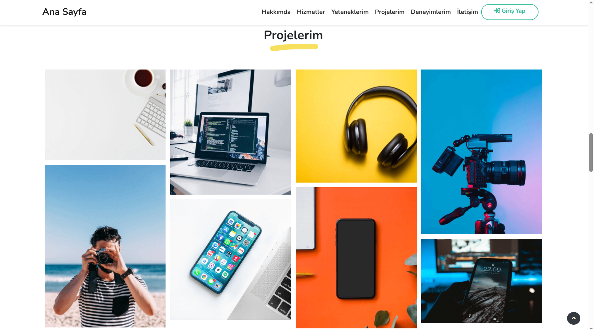
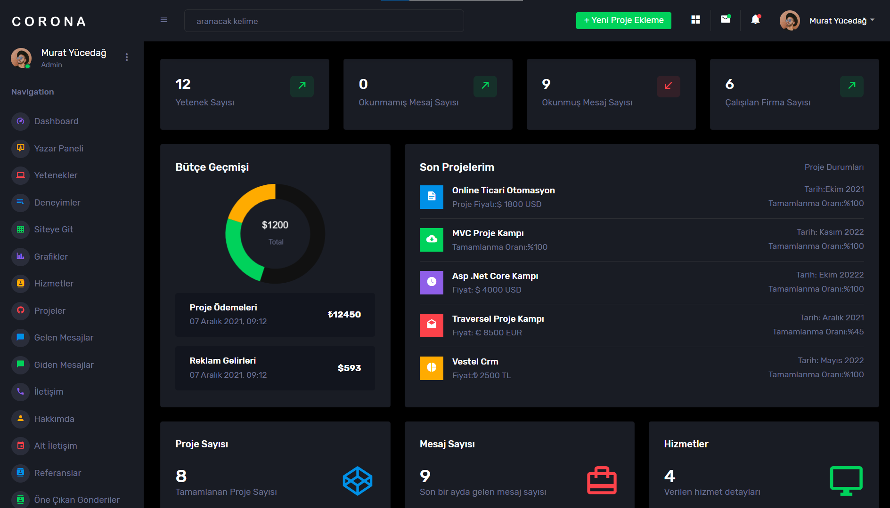
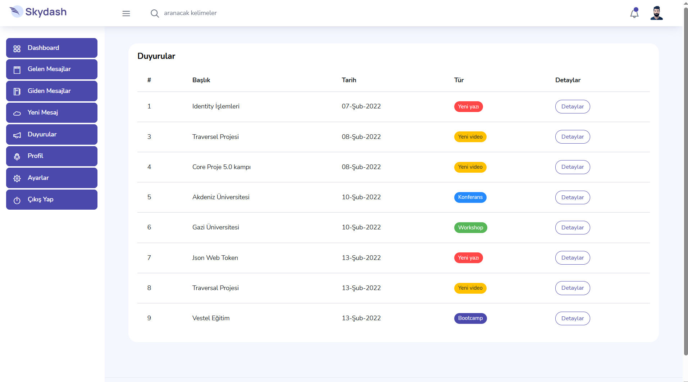

# Core Proje

ASP.NET Core MVC ile geliştirilmiş bir eğitim projesidir. Portföy vitrini, içerik yönetim paneli ve kayıtlı kullanıcılar için Writer alanı içerir. Çözümde ayrıca bağımsız bir kategori API'si bulunur.

## Arayüz hakkında

Projenin eğitim sürümünde TemplateFlip’in Super Folio teması kullanılmıştır. Ücretsiz lisans, tema dosyalarının ve temadan uyarlanan Razor görünümlerinin yeniden dağıtımına izin vermediği için bu dosyalar depoya dahil edilmemiştir. GitHub sürümünün portföy ana sayfası Bootstrap ile yeniden tasarlanmıştır. Bu nedenle depodaki arayüz, eğitim sürümünün ekran görüntüsünden farklıdır.

## Eğitim kaynağı

Proje, Murat Yücedağ'ın [Asp.Net Core 5.0 ile Adım Adım Web Geliştirme](https://www.udemy.com/course/aspnet-core-5-ile-adim-adim-web-gelistirme/) eğitimi takip edilerek geliştirilmiştir. Eğitimdeki çalışma uygulanmıştır.

Eğitim başlığında .NET 5 geçse de bu çözümdeki beş proje **.NET 10 (`net10.0`)** hedefler.

## GitHub sürümündeki vitrin

Bu kopyadaki portföy vitrini, yerel Bootstrap 5.3.3 dosyaları ve ayrı `portfolio.css` ile yeniden yazılmıştır. Beyaz zemin, koyu metin ve yeşil vurgu kullanır; sistem fontlarıyla çalışır. Super Folio HTML/CSS/JS, ikon, font ve görselleri kullanılmaz. Backend ve yönetim panelleri korunmuştur. Veritabanındaki eski tema görsel yolları değiştirilmez; /Template/ içeren veya yüklenemeyen görseller yerine bağımsız yer tutucu gösterilir.

## Teknolojiler

| Teknoloji / paket | Sürüm veya kullanım |
|---|---|
| .NET / ASP.NET Core MVC | 10 |
| Entity Framework Core ve SQL Server sağlayıcısı | 10.0.11 |
| ASP.NET Core Identity EntityFrameworkCore | 10.0.11 |
| FluentValidation.AspNetCore | 11.3.1 |
| Newtonsoft.Json.Bson | 1.0.3 |
| Swashbuckle.AspNetCore | 6.6.2; API'de Swagger |
| System.Security.Cryptography.Pkcs | 9.0.21 |
| Arayüz | Razor, Areas, ViewComponent, partial view, Bootstrap ve jQuery |

## Katmanlar

Çözüm dosyası bu README ile aynı klasördeki `Core_Proje.slnx` dosyasıdır.

| Proje | Sorumluluk | Doğrudan proje referansları |
|---|---|---|
| Core_Proje | MVC uygulaması, yönetim ekranları ve Writer alanı | BusinessLayer, DataAccessLayer, EntityLayer |
| BusinessLayer | Servis arayüzleri, Manager sınıfları ve doğrulama | DataAccessLayer, EntityLayer |
| DataAccessLayer | EF Core context, DAL arayüzleri, repository ve migration'lar | EntityLayer |
| EntityLayer | İçerik modelleri, Identity kullanıcı ve rol sınıfları | Yok |
| Core_Proje_Api | Ayrı context ve veritabanı kullanan kategori API'si | Yok |

Katmanlı mimari ve Generic Repository kullanılır. İçerik işlemlerinin bir bölümünde Manager ve DAL nesneleri doğrudan oluşturulur. Unit of Work uygulaması bulunmamaktadır.

## Kaynak kodunda bulunan özellikler

- **Vitrin:** Öne çıkan alan, hakkımda, hizmetler, yetenekler, portföy, deneyimler, referanslar ve iletişim bilgileri; veritabanına kaydedilen ziyaretçi mesajları.
- **Yönetim:** Portföy, yetenek, deneyim, hizmet, sosyal medya ve referans ekranları; hakkımda, öne çıkan alan ve iletişim bilgilerini düzenleme; ziyaretçi mesajları ve yönetici mesajlaşması; sayım istatistikleri ve yapılacaklar listesi bileşeni.
- **Writer:** Identity ile kayıt/giriş/çıkış, profil ve parola güncelleme, profil görseli yükleme, gelen/giden mesajlar, duyurular ve dashboard.
- **Doğrulama ve AJAX:** Portföy ekleme/güncellemede FluentValidation; deneyim işlemleri için AJAX kodu.
- **Hava durumu:** Writer dashboard'da isteğe bağlı OpenWeatherMap entegrasyonu. Anahtar yoksa veya HTTP, zaman aşımı ya da XML hatası oluşursa sıcaklık yerine `—` gösterilir.
- **API:** Kategori listeleme, ID ile getirme, ekleme, silme ve güncelleme; Development ortamında Swagger.

MVC uygulamasında genel oturum açma zorunluluğu vardır; vitrin, kayıt ve giriş işlemlerinde anonim erişim tanımlıdır. İçerik yönetimi controller'larının çoğu `Admin` rolü ister. API'de ayrıca kimlik doğrulama yapılandırması bulunmaz. Bu liste kaynak kodu kapsamını belirtir; tüm işlevlerin test edildiği anlamına gelmez.

## Gereksinimler

- .NET 10 SDK.
- SQL Server veya SQL Server Express; hedef veritabanını oluşturabilecek ve kullanabilecek erişim yetkisi.
- CLI migration işlemleri için `dotnet-ef` 10.0.11.
- Aşağıdaki komutlar için Windows PowerShell 5.1 veya üzeri.
- İsteğe bağlı IDE; çözüm dosyasını açmak için `.slnx` ve .NET 10 desteği.

## Kurulum

Komutları `Core_Proje.slnx` dosyasının bulunduğu klasörde çalıştırın. Aşağıdaki bölümleri sırayla, aynı PowerShell oturumunda uygulayın; koşullu araç kurulumu ve isteğe bağlı adımları gerektiğinde kullanın. Aşağıdaki işlemler hedef veritabanında şema ve kayıt oluşturur. İlk denemede mevcut veritabanınızdan ayrı, yeni bir deneme veritabanı seçin.

### 1. Araçlar ve paketler

```powershell
dotnet --version
dotnet ef --version
dotnet restore .\Core_Proje.slnx
if ($LASTEXITCODE -ne 0) { throw 'Restore başarısız.' }
```

`dotnet-ef` kurulu değilse bir kez kurun:

```powershell
dotnet tool install --global dotnet-ef --version 10.0.11
if ($LASTEXITCODE -ne 0) { throw 'dotnet-ef kurulumu başarısız.' }
```

Araç kuruluysa `dotnet ef --version` çıktısının 10.0.11 olduğunu kontrol edin. Farklı bir sürüm varsa devam etmeden önce bu sürümle uyumlu araç kurulumunu hazırlayın.

### 2. Bağlantı ortam değişkenleri

Ana uygulama ve API farklı değişkenleri okur; birbirlerinin bağlantısını kullanmaz:

| Değişken | Kullanım |
|---|---|
| `CORE_PROJE_CONNECTION_STRING` | Ana MVC uygulaması ve onun migration'ları |
| `CORE_PROJE_API_CONNECTION_STRING` | Kategori API'si ve onun migration'ı |
| `OPENWEATHERMAP_API_KEY` | İsteğe bağlı hava durumu anahtarı |

Bağlantılar context sınıflarında ortamdan okunur. `appsettings.json` veya User Secrets bağlantı kaynağı olarak kullanılmaz. Eksik/boş bağlantı değişkeninde, context kullanılırken değişken adını belirten bir hata verilir. Gerçek bağlantı bilgilerini veya parolaları kaynak dosyalarına yazmayın.

Aşağıdaki yardımcı fonksiyon PowerShell 5.1 ile uyumludur. Girdiyi ekranda gizler; uygulamaya aktarılabilmesi için dönüş değeri süreç belleğinde düz metin olur.

```powershell
function Read-ProcessSecret {
    param([string]$Prompt)

    $secureValue = Read-Host -Prompt $Prompt -AsSecureString
    $pointer = [IntPtr]::Zero
    try {
        $pointer = [Runtime.InteropServices.Marshal]::SecureStringToBSTR($secureValue)
        return [Runtime.InteropServices.Marshal]::PtrToStringBSTR($pointer)
    }
    finally {
        if ($pointer -ne [IntPtr]::Zero) {
            [Runtime.InteropServices.Marshal]::ZeroFreeBSTR($pointer)
        }
        $secureValue.Dispose()
    }
}

$env:CORE_PROJE_CONNECTION_STRING = Read-ProcessSecret 'Ana uygulama: yeni deneme veritabanının bağlantı dizesi'
```

Bağlantı dizesinde SQL Server sunucusunu, yeni deneme veritabanının adını ve kullanacağınız kimlik doğrulama yöntemini belirtin. Değişkenler bu terminal ve buradan başlatılan süreçler için geçerlidir. Uygulamayı ve EF araçlarını aynı terminalden çalıştırın. Önceden açık bir IDE bu terminalin değişkenlerini almaz.

### 3. Ana uygulama veritabanını oluşturma

Hazırlık bayrakları migration sırasında kapalı olmalıdır. Uygulama kendiliğinden migration uygulamaz.

```powershell
$env:CORE_PROJE_PREPARE_ADMIN = 'false'
$env:CORE_PROJE_PREPARE_CONTENT = 'false'

dotnet ef database update --project .\DataAccessLayer --startup-project .\Core_Proje --context DataAccessLayer.Concrete.Context
if ($LASTEXITCODE -ne 0) { throw 'Migration başarısız; başlangıç hazırlığına geçmeyin.' }
```

Ana uygulamada 17 migration bulunur. Migration'lar şemayı oluşturur; ilk Admin hesabını ve vitrin içeriklerini eklemez.

### 4. İsteğe bağlı başlangıç hazırlığı

İki seçenek de varsayılan olarak kapalıdır. Aşağıdaki örnek yeni Admin hesabını ve üç başlangıç içeriğini birlikte hazırlar. Parolayı ekrana veya komut geçmişine yazmadan girin; Identity parola kurallarına uygun bir parola seçin.

```powershell
try {
    $env:CORE_PROJE_ADMIN_USERNAME = Read-Host 'Yeni yönetici kullanıcı adı'
    $env:CORE_PROJE_ADMIN_EMAIL = Read-Host 'Deneme hesabının e-postası'
    $env:CORE_PROJE_ADMIN_PASSWORD = Read-ProcessSecret 'İlk yönetici parolası'

    $env:CORE_PROJE_PREPARE_ADMIN = 'true'
    $env:CORE_PROJE_PREPARE_CONTENT = 'true'

    dotnet run --project .\Core_Proje --no-launch-profile --no-restore
    if ($LASTEXITCODE -ne 0) { throw 'Başlangıç hazırlığı tamamlanmadı; gösterilen bildirimi inceleyin.' }
}
finally {
    $env:CORE_PROJE_PREPARE_ADMIN = 'false'
    $env:CORE_PROJE_PREPARE_CONTENT = 'false'
    Remove-Item Env:CORE_PROJE_ADMIN_PASSWORD -ErrorAction SilentlyContinue
    Remove-Item Env:CORE_PROJE_ADMIN_USERNAME -ErrorAction SilentlyContinue
    Remove-Item Env:CORE_PROJE_ADMIN_EMAIL -ErrorAction SilentlyContinue
}
```

- **Admin seçeneği:** `RoleManager` ve `UserManager` ile rolü ve yeni hesabı oluşturur. Mevcut kullanıcı adı veya e-posta eşleşmesinde durur; mevcut hesaba yetki vermez, parolasını veya profilini değiştirmez. İkinci çalıştırmada da kayıt çoğaltmadan bu nedenle durur.
- **İçerik seçeneği:** About, Feature ve Contact tablolarında ID'si `1` olan kayıtları bekleyen düzenleme ekranları için kişisel bilgi içermeyen örnekler oluşturur. ID `1` varsa değiştirmez. ID `1` yokken başka kayıt varsa durur. Boş tablonun identity sayacı `1` üretmezse kayıt değişikliklerini geri alır; sayaçları sıfırlamaz.
- İki seçenek birlikte açıldığında işlemler aynı transaction içindedir. Admin eşleşmesi varsa içerik hazırlığı da uygulanmaz.
- Yalnızca içerik hazırlamak için Admin bayrağını `false`, içerik bayrağını `true` bırakın; hesap değişkenleri gerekmez. Yalnızca Admin hazırlamak için içerik bayrağını `false` yapın.
- Başarıda veya hazırlık hatasında uygulama web sunucusunu başlatmadan çıkar. Başarısızlık çıkış kodu `1` olur. Normal çalıştırmadan önce bayrakları kapatın.
- Diğer vitrin verileri, mesajlar ve API kategorileri bu hazırlıkta eklenmez. Profil görseli ve örnek içerik görselleri de oluşturulmaz.

### 5. Ana uygulamayı çalıştırma

Bağlantı değişkeninin bulunduğu terminalde:

```powershell
$env:CORE_PROJE_PREPARE_ADMIN = 'false'
$env:CORE_PROJE_PREPARE_CONTENT = 'false'
dotnet run --project .\Core_Proje --launch-profile https --no-restore
```

HTTPS geliştirme sertifikası güvenilir olmalıdır; gerekirse `dotnet dev-certs https --trust` komutunu kullanın. HTTPS profilindeki adresler:

- [Vitrin](https://localhost:7065/)
- [Giriş](https://localhost:7065/Writer/Login/Index)
- [Yönetici dashboard](https://localhost:7065/Dashboard/Index)
- [Writer alanı](https://localhost:7065/Writer/Default/Index)

Giriş sonrası yönlendirme Writer alanınadır. Admin hesabı yönetici ekranlarına da erişebilir; normal kayıt akışı Admin rolü atamaz.

Hava durumu istenirse aynı terminalde `OPENWEATHERMAP_API_KEY` değişkenini `Read-ProcessSecret` ile tanımlayın. Tanımlanması zorunlu değildir.

### 6. İsteğe bağlı API kurulumu

API ayrı çalışır. Ana uygulama terminali meşgul ettiği için API'yi ikinci bir PowerShell terminalinde başlatın veya ana uygulamayı `Ctrl+C` ile durdurun. Yeni terminalde `Core_Proje.slnx` klasörüne geçip yukarıdaki `Read-ProcessSecret` fonksiyonunu yeniden tanımlayın. API için ana uygulamadan farklı bir deneme veritabanı seçin.

```powershell
$env:CORE_PROJE_API_CONNECTION_STRING = Read-ProcessSecret 'API: ayrı deneme veritabanının bağlantı dizesi'

dotnet ef database update --project .\Core_Proje_Api --startup-project .\Core_Proje_Api --context Core_Proje_Api.DAL.ApiContext.Context
if ($LASTEXITCODE -ne 0) { throw 'API migration başarısız.' }

dotnet run --project .\Core_Proje_Api --launch-profile https --no-restore
```

API'de bir migration vardır. Development ortamında [Swagger](https://localhost:7292/swagger) kullanılabilir; kategori uç noktası `/api/Category` şeklindedir. API için seed hazırlığı yoktur. Bu kurulum ve API işlevleri çalışma zamanında doğrulanmış olarak sunulmamaktadır.

## Doğrulama durumu ve sınırlamalar

Proje sahibi tarafından önceki eğitim sürümünde, ayrı deneme veritabanında şu işlemler doğrulanmıştır:

- Ana uygulamanın migration ile sıfırdan kurulumu.
- İsteğe bağlı başlangıç hazırlığı.
- Admin hesabıyla giriş.
- About, Feature ve Contact düzenleme ekranları.

Çözümün restore ve derlemesi de kontrol edilmiştir. Son paket denetiminde dolaylı bağımlılıklar dahil bilinen güvenlik açığı içeren NuGet paketi bildirilmemiştir; bu sonuç denetimin yapıldığı andaki veriye dayanır. Nullable ve çakışan route uyarıları devam etmektedir. Otomatik test projesi bulunmamaktadır.

GitHub kopyasının yeni vitrini için masaüstü/mobil tarayıcı doğrulaması henüz tamamlanmamıştır. API, diğer CRUD işlemleri, mesajlaşma, dosya yükleme ve dış servis entegrasyonu test edilmiş kabul edilmemelidir. Bazı dashboard alanları statik tema içeriğidir. Mesaj sahipliği, kullanıcı verilerinin JSON'a aktarılması ve yüklenen dosyaların doğrulanması gibi alanlar yayın öncesinde ayrıca incelenmelidir. Yönetici mesajlaşmasının bazı bölümlerinde sabit alıcı/gönderici adresi vardır; hazırlanan hesabın e-postasıyla otomatik eşleşmez.

## Ekran görüntüleri

### Portföy Vitrini — Projelerim (önceki eğitim sürümü)



Super Folio kullanılan eğitim sürümünden ekran görüntüsü.

### Yönetici Dashboard



### Writer Paneli — Duyurular



## Temalar ve lisanslar

Bu README projenin tamamına MIT veya başka bir ortak lisans atamaz. Üçüncü taraf dosyaların kendi lisansları ve atıfları geçerlidir.

| Tema / bileşen | Mevcut bildirim |
|---|---|
| GitHub vitrini: Bootstrap 5.3.3 | [MIT lisansı](Core_Proje/wwwroot/lib/bootstrap/LICENSE) |
| Argon Dashboard / Creative Tim | [MIT lisansı](Core_Proje/wwwroot/argon-dashboard-master/LICENSE.md) |
| Corona / BootstrapDash | [MIT lisansı](Core_Proje/wwwroot/corona-free-dark-bootstrap-admin-template-1.0.0/LICENSE) |
| Skydash / BootstrapDash | [README içindeki MIT bildirimi](Core_Proje/wwwroot/skydash/README.md) |
| Argon içindeki jvectormap-next | [AGPL metni](Core_Proje/wwwroot/argon-dashboard-master/assets/vendor/jvectormap-next/LICENSE-AGPL) ve [ticari lisans metni](Core_Proje/wwwroot/argon-dashboard-master/assets/vendor/jvectormap-next/LICENSE-COMMERCIAL) |
| Skydash içindeki TinyMCE | [Yerel LGPL 2.1 metni](Core_Proje/wwwroot/skydash/vendors/tinymce/license.txt) |

TemplateFlip, Super Folio dosyalarının ve uyarlanmış Razor içeriklerinin ücretsiz lisansla GitHub üzerinde dağıtılmasına izin verilmediğini bildirmiştir. Bu nedenle GitHub kopyasındaki vitrin yeniden yazılmış ve `wwwroot/Template` ağacı kaldırılmıştır. Önceki portföy ekran görüntüsü yukarıda açıkça eğitim sürümü olarak etiketlenmiştir. Diğer yönetim temalarının lisansları ve alt bileşen değerlendirmeleri geçerliliğini korur.

Ana temaların MIT bildirimi bütün alt bileşenlere uygulanamaz. Özellikle harita bileşenleri, TinyMCE, fontlar ve görsellerin dağıtım koşulları ayrı değerlendirilmelidir. Mevcut lisans ve atıf dosyaları korunmalıdır.
